# 实验三：逐屏截图评审与视觉改版

> 截图于 2026-10-15 在 1366 × 768 浏览器视口采集。`current/` 是当前项目实际页面；`proposal/` 是基于 `prototype.html` 绘制的**静态界面概念图**，不是已开发的前端。概念图里的飞机状态、覆盖率、时间和分数都是说明交互的**示例数据**，不能当成真实仿真结果。点击图片可看原始尺寸。

## 先看结论

- **五个任务不是五个同时展开的配置页**：入口只展示五张简要任务入口；选择一关后只展示该任务所需成员和地图。五关顺序训练；综合任务另行解锁，不默认把 15 架机全部铺开。
- **一个任务中的单机配置，和整关只用单机是两件事**：前者选中成员，侧栏修改本次角色、子任务、高度、速度和起降点；后者是支持时才开放的单机基线，不出现组级接力/主辅设置，也不冒充多机协作通关。
- **多机协作必须有分工**：先确定任务目标与子任务，再分配成员/角色、组级规则和接替条件；每次改动使旧检查失效。运行中保留组级视图和单机聚焦，不用十五张卡片争抢空间。
- **异常属于执行过程，报告属于真实运行**：异常出现时在执行页显示影响、待处置状态和安全策略；未处理不能“完成运行”。报告按本次运行产生，失败/中止也记录，不能提前给满分和五关全完成。

## 1. 任务入口：五图并排 → 一次聚焦一关

| 当前：任务认知 | 提案：选择任务与目标 |
| --- | --- |
| [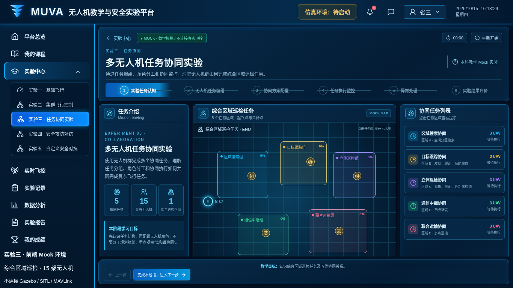](current/1-intro.png) | [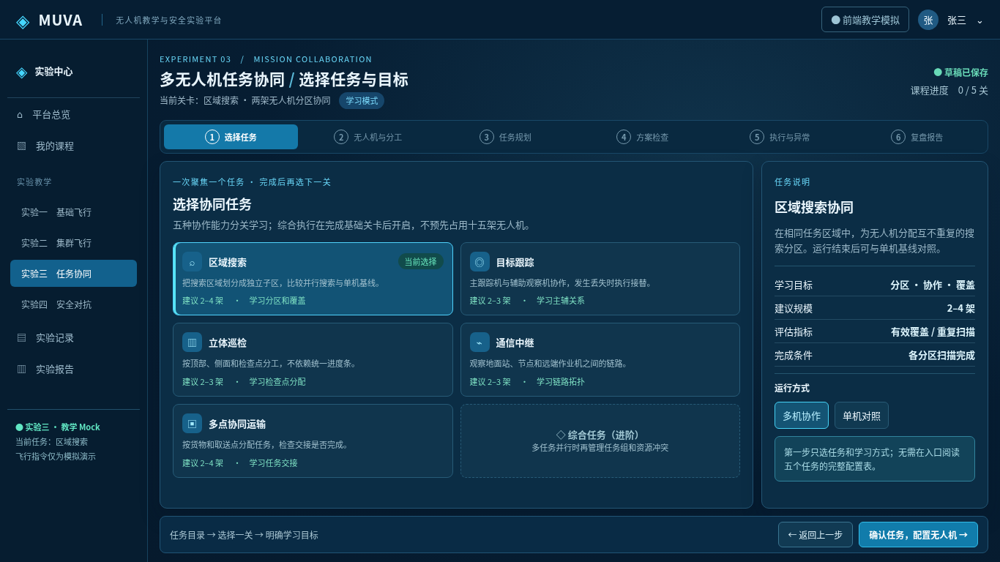](proposal/1-task-selection.png) |

**看到的问题**：当前在一屏同时给出五个组的地图、五张任务卡、`5 协同任务 / 15 参与无人机`，却没有说明学生应先完成哪一关，也把“综合区域巡检”误读成一次性全量并行。**设计调整**：左侧五个简要入口，右侧仅解释当前选中的区域搜索；选择“多机协作”或“单机对照”，明确 2–4 架只是建议规模，而非预先占有资源。**操作变化**：选择一个任务和运行方式后才进入本关编组；每关独立进度和结果，综合任务在基础关完成后单独进入。

## 2. 无人机编组：十五张卡 → 本关成员表 + 单机侧栏

| 当前：无人机任务编组 | 提案：成员与单机配置 |
| --- | --- |
| [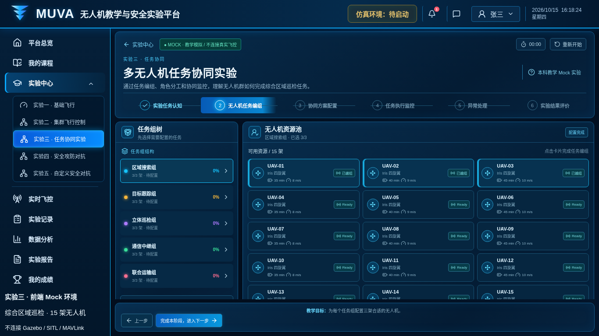](current/2-assignment.png) | [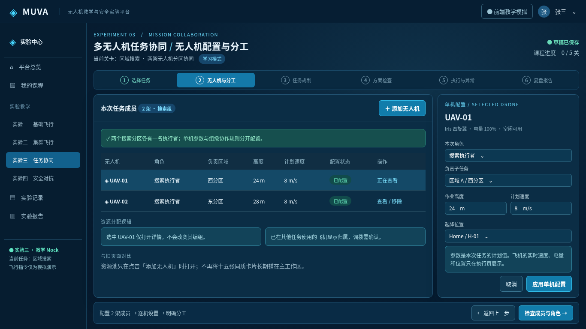](proposal/2-drone-setup.png) |

**看到的问题**：右侧常驻 15 张卡，底部卡片被裁切；左侧同时列五个组。看不出“选中查看”和“加入/移除”、当前计划值和资源事实的区别。**设计调整**：常驻区只展示本关两名已编成员的角色、负责分区与计划高度/速度；选中 UAV-01 后在侧栏编辑**这架飞机的本次任务计划**，不把全局协作规则复制到每架机上。**操作变化**：单击一行只聚焦；修改后“应用单机配置”，退出编辑可取消；加入/移除是独立动作，不能点一下卡片就暗中分配。

**资源池仅在需要时打开**，仍可搜索或查看占用原因；已占用飞机不能无提示抢占。加入新成员后要补角色和子任务，旧检查自动失效：

[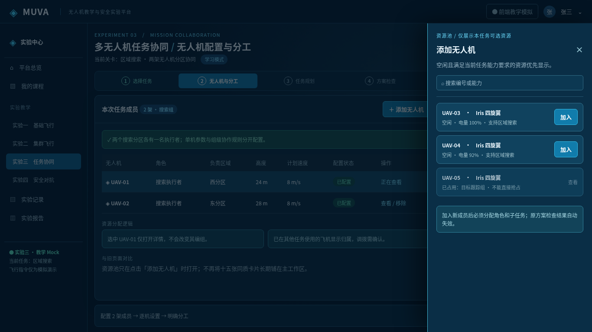](proposal/2-resource-drawer.png)

若选择**整关单机对照**：只列一架飞机、目标与串行路线；保留单机任务参数，不出现主机/僚机、接力和跨机交接；应单独报告与多机方案的耗时、覆盖、能耗差异。对于不支持单机的教学关卡应明确禁用并给出原因。

## 3. 协作规划：选择模式卡 → 明确分区、执行者、失败接替

| 当前：协同方案配置 | 提案：任务规划与组级规则 |
| --- | --- |
| [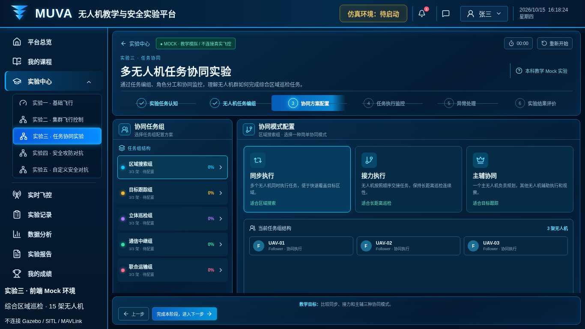](current/3-strategy.png) | [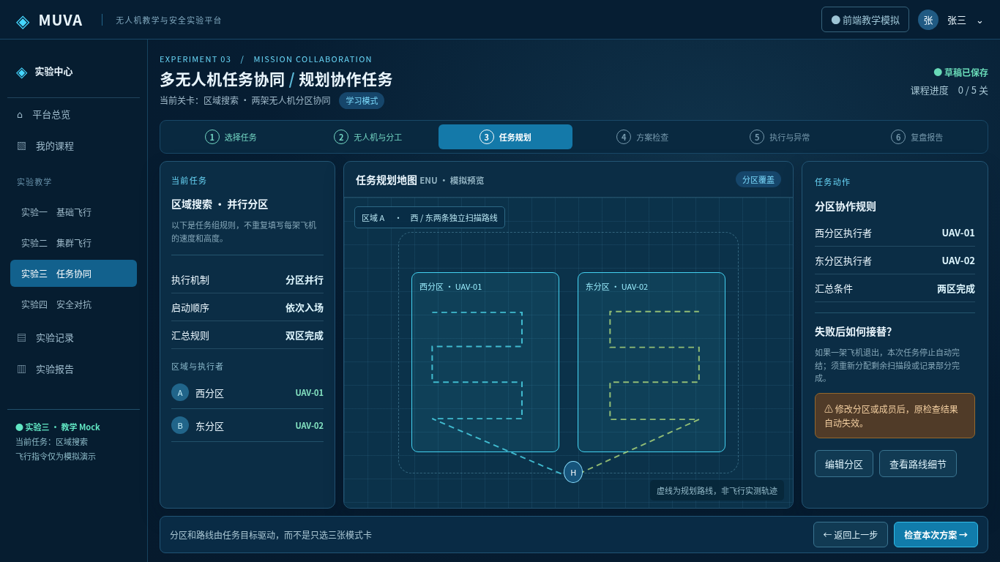](proposal/3-mission-planning.png) |

**看到的问题**：当前只有“同步执行、接力执行、主辅协同”三张抽象卡；区域搜索中三架都显示 `Follower`，没有谁执行哪个分区、怎么汇合或失败后怎么办。**设计调整**：三栏分别展示组级机制、可视任务区及路径、区域到执行者的对应与接替规则；例如西区 UAV-01、东区 UAV-02，两个区域完成才汇总结果。**操作变化**：可调整分区、分配动作和路线；更换成员或分区使检查版本失效。图中的路线只是**规划预览**，不是已经执行的轨迹。

五种任务不能套同一套“三模式”：区域搜索按分区和覆盖合并；目标跟踪设主跟踪、辅助观察和丢失接替；立体巡检按检查点与视角交接；通信中继按站点、拓扑和失联退路；联合运输按载荷、时间窗和交接。各关显示对应的字段、验证项和评价指标。若要五关一起调度，需另设**综合任务总览**，用组卡和资源冲突提示，而不是将五关表单叠在一页。

## 4. 启动前：补上方案检查与预演

| 当前：配置后直接进入执行（无独立检查） | 提案：方案版本 v2 的检查与时序预演 |
| --- | --- |
| [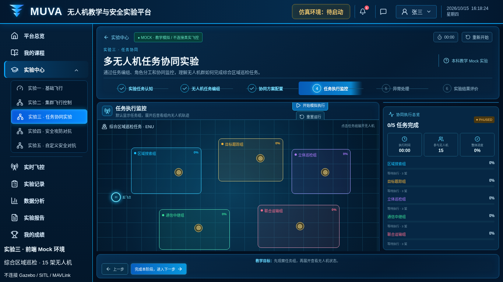](current/4-execution.png) | [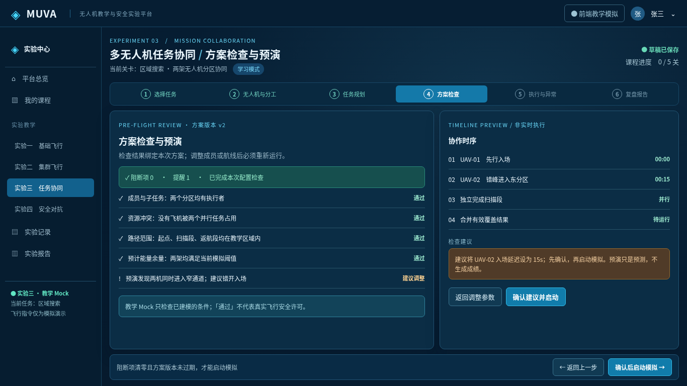](proposal/4-plan-validation.png) |

**看到的问题**：当前第 3 步选完模式即可进入第 4 步执行，缺少明确的成员、资源冲突、路线范围及能量校验；“完成阶段”不等于有可运行方案。**设计调整**：增加检查结果、阻断数、警告、方案版本和非实时协作时序；建议错峰入场要能返回修改。**操作变化**：阻断项为零且当前配置通过检查才可启动；修改成员或规则后重新检查。教学 Mock 的检查不能被描述成真实飞行安全许可。

## 5. 执行监控：总览、地图、单机和异常同屏

| 当前：五组总览同时展开 | 提案：当前任务组执行监控 |
| --- | --- |
|  | [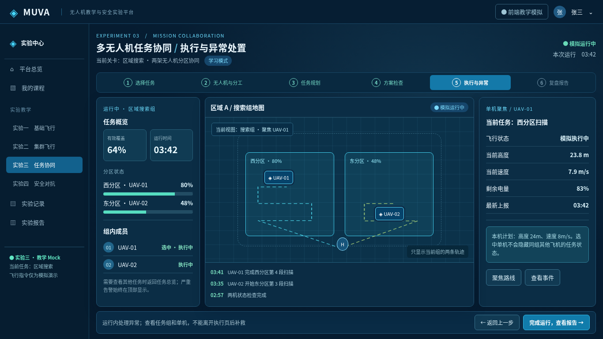](proposal/5-live-monitor.png) |

**看到的问题**：五个组的地图和 15 架飞机挤在同一视图，当前执行组不突出；点一架飞机后，旧图下方详情在固定高度页面被截断：

[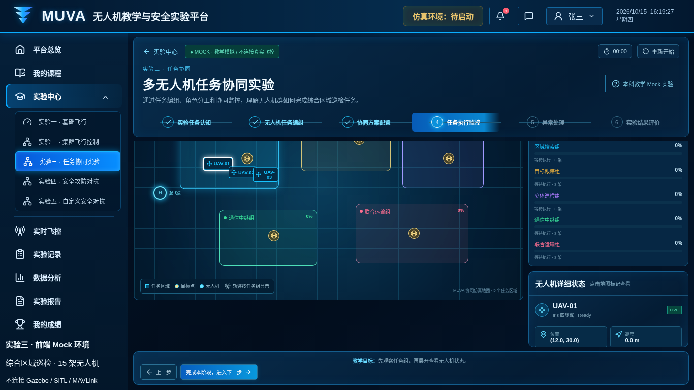](current/4-execution-drone-focus.png)

**设计调整**：左栏只呈现本组指标与成员；中栏聚焦本组两条任务路线、分区和事件；右栏展示**选中 UAV-01 的实时**高度、速度、电量及计划值对照。**操作变化**：组视图和单机视图可切换，选中一架不隐藏其他组员；要看别的任务先回综合任务总览，不把十五架机都塞进当前地图。

### 异常：不能离开运行页才补处理

| 当前：运行之后才到独立异常页 | 提案：运行中的待处置告警 |
| --- | --- |
| [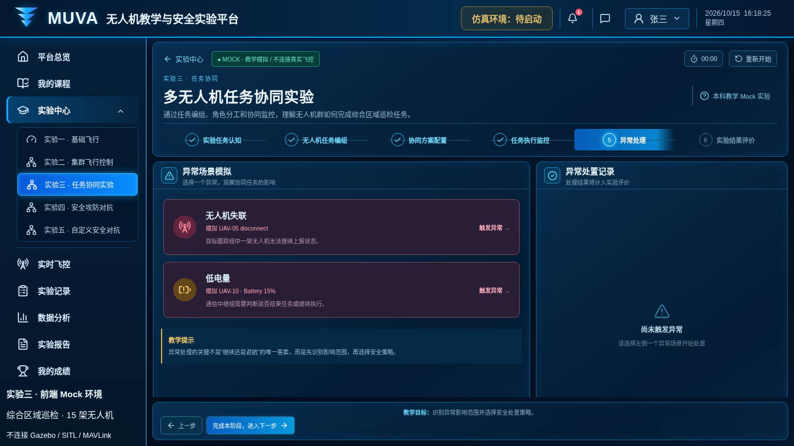](current/5-failure.png) | [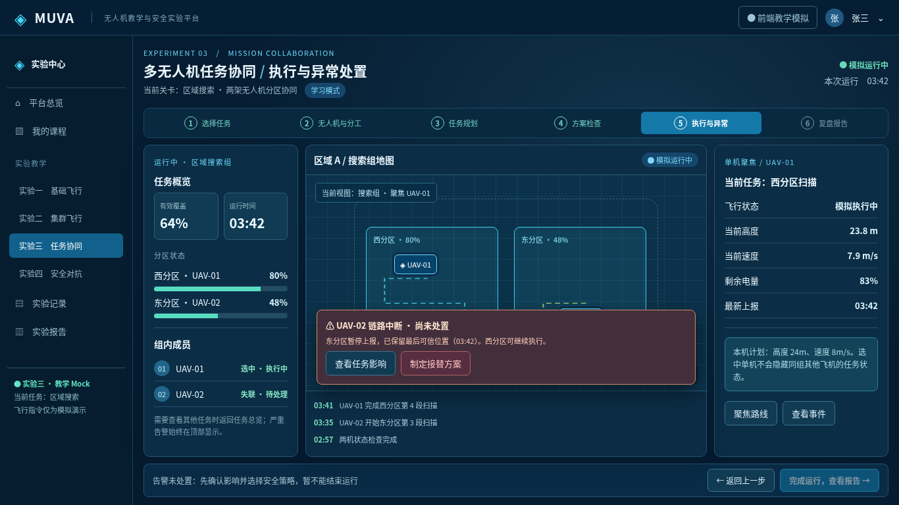](proposal/5-incident-overlay.png) |

当前进入“异常处理”后再手动点“触发异常”，点后可见缺少后果分解的“继续执行/返航”：

[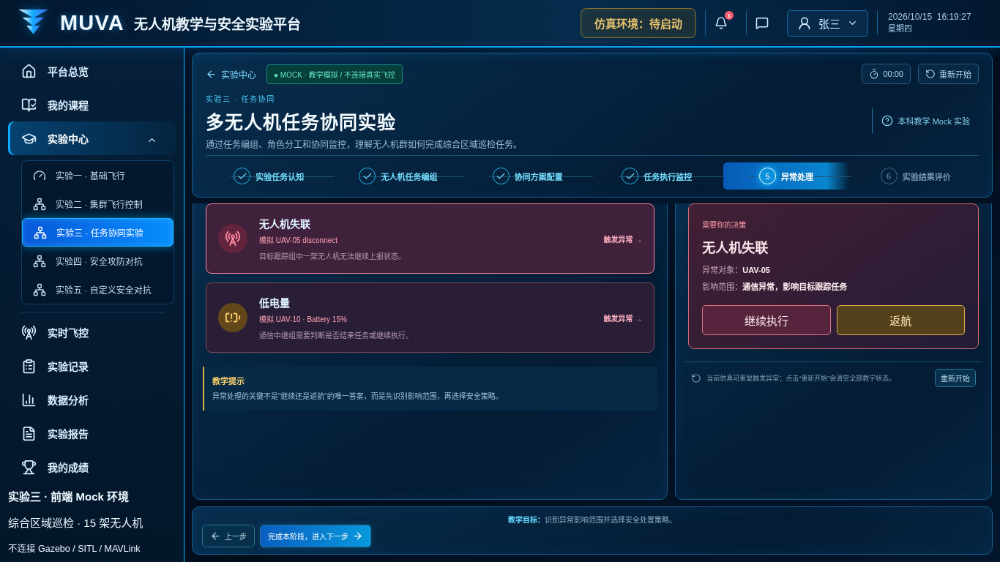](current/5-failure-triggered.png)

**操作变化**：异常在运行时产生，显示对象、最后可信上报、受影响分区和未受影响任务；UAV-02 状态变为“失联·待处理”，完成运行按钮暂不可用；先查看影响，再选“保留部分完成 / 安全停止 / 制定接替”等场景允许的策略，记录决策与结果，不允许下一帧把待处理事件冲掉。异常若用于考核应在启动前明确考核模式，不靠运行结束后补触发。

## 6. 报告：固定满分 → 本次任务的证据与复盘

| 当前：未执行即显示综合成绩 | 提案：一次区域搜索运行报告 |
| --- | --- |
| [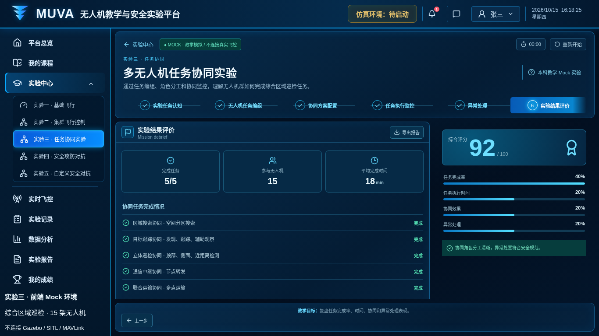](current/6-report.png) | [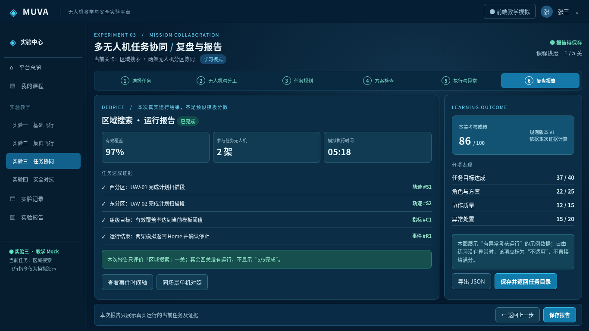](proposal/6-run-report.png) |

**看到的问题**：旧图在五组都未真正运行的情况下展示 `5/5`、`15` 架、`18 min`、`92/100` 与全部完成。**设计调整**：左侧只列本关实际任务结果和轨迹/指标/事件证据索引；右侧给按规则版本计算的单关分项结果。**操作变化**：仅运行达到终态后生成报告；未执行不能生成成绩；中止/失败记录真实状态；异常考核未发生则标“不适用”并按可解释规则处理，不无条件送满分。概念图里的 `97%`、`86/100` 仍是示例，不代表当前系统算出了这些结果。

## 实施边界与优先级

1. **先修流程与状态**：按关卡管理当前任务和草稿；成员唯一占用；未完成配置/检查不能越步；异常在运行中有待处理状态，报告只基于终态快照。
2. **再做编排 UI**：任务目录 → 本关成员表/资源抽屉 → 单机详情 → 任务专属规划 → 可解释检查 → 组级监控/单机聚焦。
3. **最后做考核与综合任务**：证据关联评分、单机基线对比、多关总览和跨组资源冲突；不要把概念稿的数字、轨迹与评分硬编码进真实页面。

更完整的任务数据、状态机和五关协作规则见 [实验三完整评审与改版方案](../../EXPERIMENT3_REVIEW_AND_REDESIGN.md)。概念稿可在浏览器打开 [`prototype.html`](prototype.html)，用 `?screen=1` 至 `?screen=6` 切屏；资源池用 `?screen=2&variant=resources`，异常用 `?screen=5&variant=incident`。该 HTML **仅用于截图评审，不具备交互或业务逻辑**。
